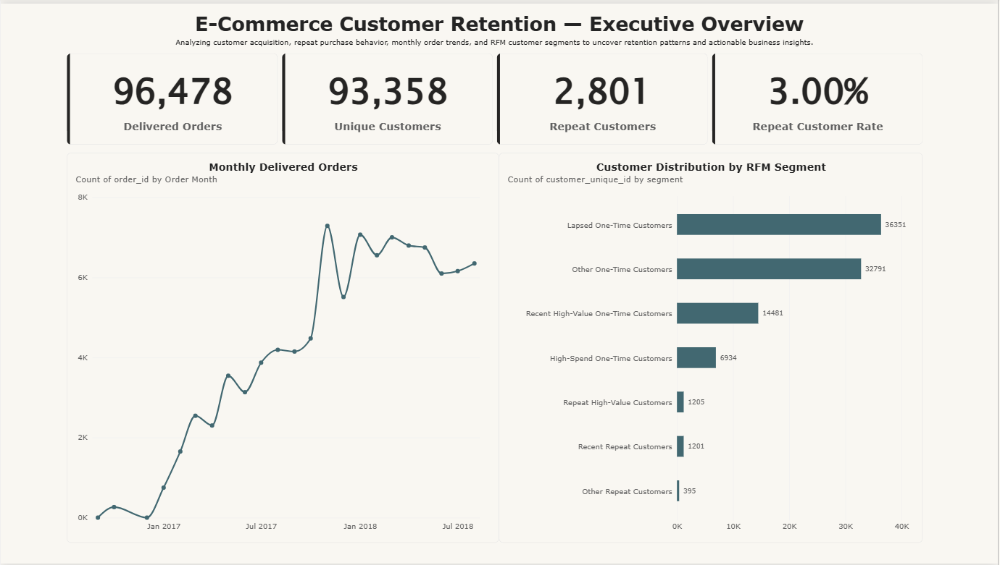
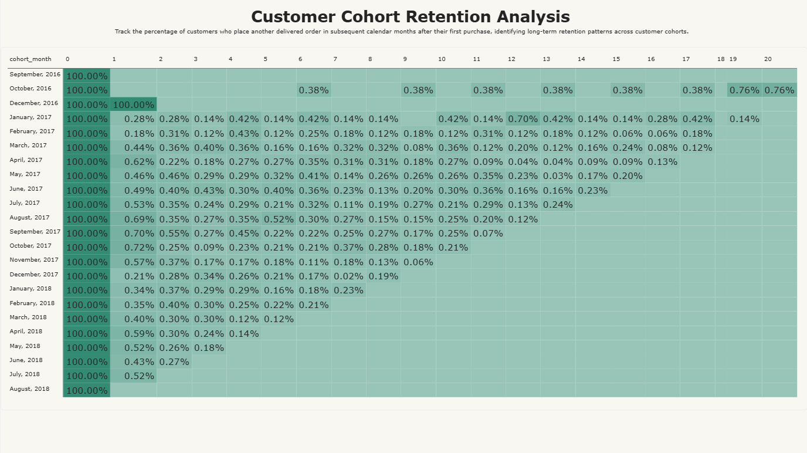
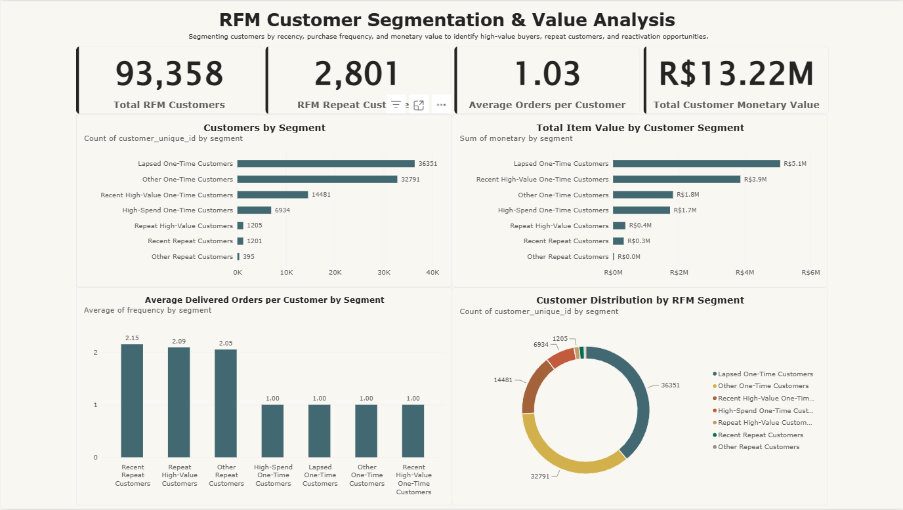
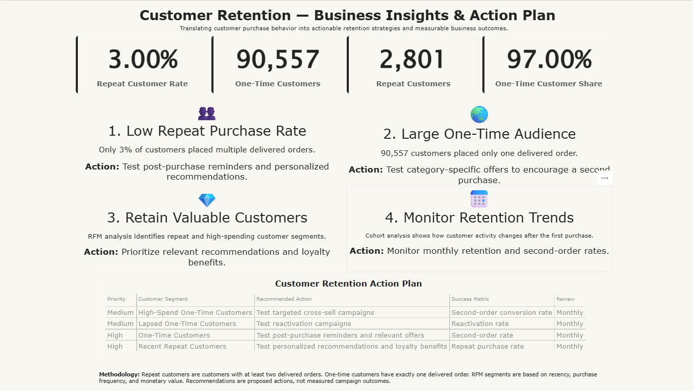

# Olist E-commerce Customer Retention & Cohort Analysis

An end-to-end data analytics project focused on understanding customer purchasing behaviour, retention patterns, cohort performance, and customer value using Python, SQL, and Power BI.

## Project Overview

Customer retention is an important indicator of business performance in e-commerce. Acquiring new customers is valuable, but understanding how existing customers return, purchase again, and contribute to revenue is equally important.

This project analyses the Brazilian E-Commerce Public Dataset by Olist to identify customer retention patterns, evaluate repeat purchasing behaviour, segment customers using RFM analysis, and develop actionable business recommendations.

The project combines Python-based data analysis, SQL querying, and an interactive Power BI dashboard to transform raw transactional data into meaningful business insights.

## Business Objectives

- Analyse overall customer purchasing behaviour.
- Measure repeat purchase rates and customer retention.
- Perform cohort analysis to understand customer retention over time.
- Segment customers using Recency, Frequency, and Monetary (RFM) analysis.
- Identify high-value and low-engagement customer segments.
- Develop data-driven recommendations to improve customer retention.

## Tools & Technologies

| Tool | Purpose |
|---|---|
| Python | Data cleaning, transformation and analysis |
| Pandas & NumPy | Data manipulation |
| Matplotlib & Seaborn | Data visualization |
| Jupyter Notebook | Exploratory data analysis |
| SQL / SQLite | Database management and querying |
| Power BI | Interactive dashboard development |
| Excel / CSV | Data storage and inspection |
| VS Code | Development environment |
| Git & GitHub | Version control |

## Dataset

**Dataset:** Brazilian E-Commerce Public Dataset by Olist

**Source:** [Kaggle – Olist Brazilian E-Commerce Dataset](https://www.kaggle.com/datasets/olistbr/brazilian-ecommerce)

The dataset contains Brazilian e-commerce transactions and related information, including:

- Customers
- Orders
- Order items
- Payments
- Products
- Sellers
- Reviews
- Geolocation

The analysis focuses primarily on delivered orders and customer purchasing behaviour.

## Project Structure

```text
ecommerce-customer-retention/
│
├── data/
│   ├── raw/
│   └── processed/
│
├── notebooks/
│   ├── 01_data_quality_eda.ipynb
│   └── 02_customer_retention.ipynb
│
├── powerbi/
│   └── customer_retention_dashboard.pbix
│
├── sql/
│   └── 01_customer_retention.sql
│
├── check_dataset.py
├── data_quality.py
├── prepare_data.py
├── create_database.py
├── run_sql.py
├── customer_retention_analysis.py
├── cohort_analysis.py
├── rfm_analysis.py
│
├── requirements.txt
├── .gitignore
└── README.md
```

## Analysis & Methodology

### 1. Data Cleaning and Exploratory Data Analysis

- Inspected dataset structure and data types.
- Checked missing values and duplicate records.
- Analysed order statuses and delivery information.
- Prepared the transactional data for further analysis.

### 2. Customer Retention Analysis

- Identified unique purchasing customers.
- Analysed one-time and repeat customers.
- Calculated customer retention metrics.
- Evaluated repeat purchasing behaviour.

### 3. Cohort Analysis

Customers were grouped into cohorts based on the month of their first delivered purchase.

The analysis measures how many customers from each cohort made subsequent purchases in later calendar months.

**Retention Rate Formula:**

Retention Rate = (Active Customers in a Cohort Period / Original Cohort Size) × 100

Month 0 represents the initial purchase month and has a retention rate of 100%.

### 4. RFM Customer Segmentation

RFM analysis evaluates customer value using three dimensions:

- **Recency:** How recently a customer made a purchase.
- **Frequency:** How frequently a customer purchased.
- **Monetary:** Total value of purchased items.

Customers are scored and grouped into segments to identify differences in purchasing behaviour and customer value.

Monetary calculations use item prices (excluding freight charges) in Brazilian Real (BRL).

### 5. SQL Analysis

SQL and SQLite were used to perform structured analysis of customer purchasing behaviour and cohort retention.

## Key Business Findings

Based on the delivered-order analysis:

| Metric | Result |
|---|---:|
| Delivered Orders | 96,478 |
| Unique Purchasing Customers | 93,358 |
| Repeat Customers | 2,801 |
| One-Time Customers | 90,557 |
| Repeat Customer Rate | 3.00% |
| One-Time Customer Share | 97.00% |

### Key Insights

1. **Low Repeat Purchase Rate:** Only 3% of purchasing customers made repeat purchases, indicating a significant customer retention opportunity.

2. **High One-Time Customer Share:** Approximately 97% of customers purchased only once during the analysed period.

3. **Retention Opportunity:** Cohort analysis helps identify how customer engagement changes after the first purchase.

4. **Customer Value Differences:** RFM segmentation highlights differences in customer purchasing frequency, recency, and monetary contribution.

## Power BI Dashboard

The Power BI report contains four analytical pages:

**1. Executive Overview**
- Overall business KPIs
- Customer purchasing metrics
- Retention overview



**2. Cohort Retention Analysis**
- Monthly customer cohorts
- Cohort retention matrix
- Customer retention trends




**3. RFM Customer Segmentation**
- Customer segment distribution
- Recency, Frequency and Monetary analysis
- Customer value comparison



**4. Business Insights & Recommendations**
- Key analytical findings
- Customer retention opportunities
- Recommended business actions



## Business Recommendations

Based on the analysis, the following strategies can help improve customer retention:

- Introduce targeted repeat-purchase campaigns.
- Develop loyalty and reward programmes.
- Use personalized offers based on customer purchasing behaviour.
- Re-engage inactive customers through targeted campaigns.
- Focus on high-value customer segments.
- Monitor cohort retention to evaluate marketing effectiveness.

## How to Run the Project

### 1. Clone the repository

```bash
git clone https://github.com/Paranubhav-20/Olist-Ecommerce-Customer-Retention-Analysis.git
```

### 2. Navigate to the project directory

```bash
cd Olist-Ecommerce-Customer-Retention-Analysis
```

### 3. Create a virtual environment

```bash

python -m venv venv
```

Activate it on Windows:

```bash
venv\Scripts\activate
```

### 4. Install dependencies

```bash
pip install -r requirements.txt
```

### 5. Download the dataset

Download the Olist dataset from Kaggle and place the required CSV files inside:

```text
data/raw/
```

### 6. Run the analysis

Open the Jupyter notebooks inside the `notebooks/` directory to explore the analysis and visualizations.

The Python scripts and SQL queries are also included for the corresponding analytical workflows.

### 7. Open the Power BI Dashboard

Open:

```text
powerbi/customer_retention_dashboard.pbix
```

in Power BI Desktop.

## Future Improvements

- Develop a Streamlit-based interactive analytics application.
- Introduce customer lifetime value (CLV) analysis.
- Develop predictive models for customer churn.
- Implement automated reporting.
- Explore customer purchasing trends over time.

## Author

**Paranubhav Dash**

Data Analytics | Python | SQL | Power BI

GitHub: [Paranubhav-20](https://github.com/Paranubhav-20)

---

*This project was developed as an end-to-end data analytics portfolio project to demonstrate data cleaning, exploratory analysis, SQL querying, customer segmentation, retention analysis, and business intelligence reporting.*
